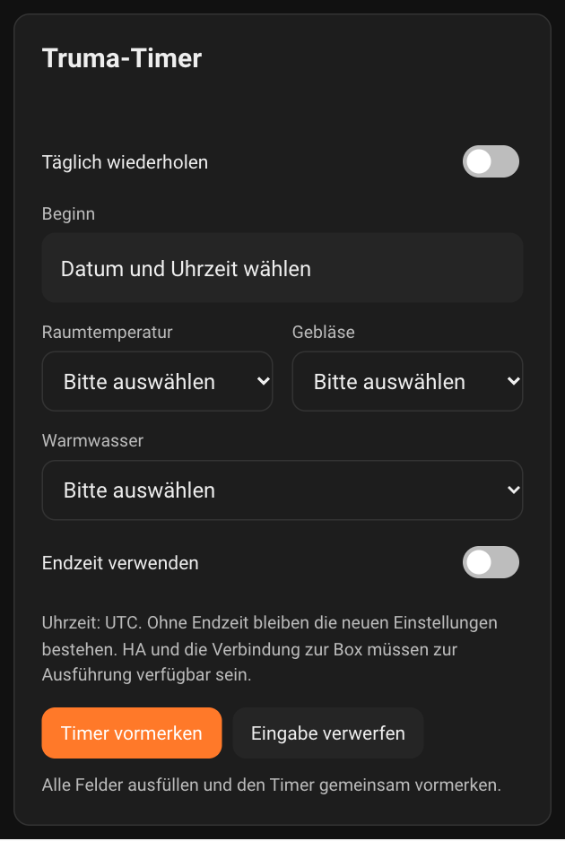

# Truma iNet Dashboard

[English](README.md)

**Dieses HACS-Paket enthält nur die Dashboard-Karten.** Du brauchst eine klassische Truma iNet-Box und die **[Truma iNet Bridge](https://github.com/Lorilonlon/truma-home-assistant-bridge/blob/main/README.de.md)**, die über Bluetooth mit der Box gekoppelt und per MQTT mit Home Assistant verbunden ist. Richte zuerst die Bridge ein. Für Zeitpläne brauchst du zusätzlich die [Timer-Helfer, das Skript und die Automation](https://github.com/Lorilonlon/truma-home-assistant-bridge/blob/main/dashboard/TIMER.md).

Mit diesen Karten steuerst du Heizung und Warmwasser, planst Timer und siehst Gerätemeldungen deiner klassischen Truma iNet-Box in Home Assistant.



## Einrichtung

1. Installiere und kopple zuerst die [Truma iNet Bridge](https://github.com/Lorilonlon/truma-home-assistant-bridge/blob/main/README.de.md). Sie stellt die benötigten MQTT-Entitäten bereit. Für die Timerkarte brauchst du zusätzlich die [Timer-Helfer, das Skript und die Automation](https://github.com/Lorilonlon/truma-home-assistant-bridge/blob/main/dashboard/TIMER.md).
2. Öffne [Truma iNet Dashboard in HACS](https://my.home-assistant.io/redirect/hacs_repository/?owner=Lorilonlon&repository=truma-inet-dashboard&category=plugin). Falls es in der Suche noch fehlt, füge dieses GitHub-Repository unter „Benutzerdefinierte Repositories“ mit dem Typ „Dashboard“ hinzu. Lade das Paket herunter und lade die Browserseite neu.
3. Bei über die Oberfläche verwalteten Dashboards trägt HACS das Modul ein. Verwaltet dein Dashboard Ressourcen über YAML, trage `/hacsfiles/truma-inet-dashboard/truma-inet-dashboard.js` als JavaScript-Modul ein. Hast du die Karten zuvor manuell installiert, behalte deine Kartenkonfigurationen. Sobald die HACS-Ressource eingetragen ist, entferne die alten Ressourceneinträge für `camper-inet-card.js` und `camper-inet-fault-card.js` und lade die Browserseite neu.
4. Lege eine manuelle Karte an und füge das Beispiel ein. Passe die Entitäts-IDs an deine Installation an.

```yaml
type: custom:camper-inet-card
kind: climate
entity: climate.truma_inet_heizung
```

Für Warmwasser verwende `kind: water` mit `select.truma_inet_warmwasser`. Beide Karten erkennen die aktuellen und früheren Standard-IDs der Temperatursensoren. Messwerte sind auch im Lesemodus sichtbar. Für einen umbenannten Sensor trage seine Entitäts-ID unter `temperature_entity` ein. Für Timer und Meldungen gibt es die Kartentypen `custom:camper-inet-timer-card` und `custom:camper-inet-fault-card`. [Vollständiges Beispiel](https://github.com/Lorilonlon/truma-home-assistant-bridge/blob/main/dashboard.json).

Wie in der Truma-App kannst du eine Heizungsstörung über die klassische iNet-Box nicht aus der Ferne zurücksetzen. „Gesehen“ bestätigt die Meldung in Home Assistant. Die Karten steuern eine echte Heizung. Teste Einstellungen vor Ort und beachte die Herstelleranleitung. Experimentelles, unabhängiges Community-Projekt mit Unterstützung von OpenAI Codex. [MIT-Lizenz](LICENSE).
