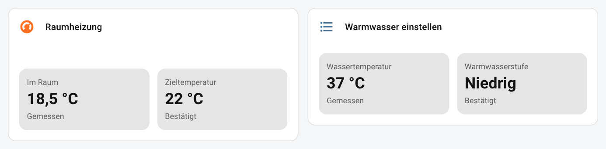
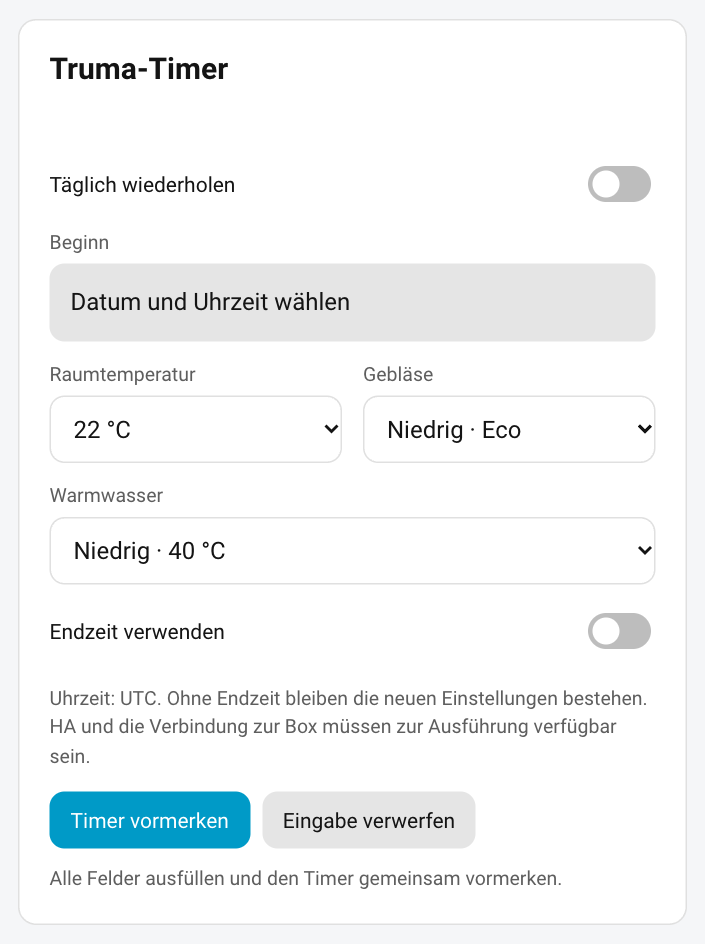
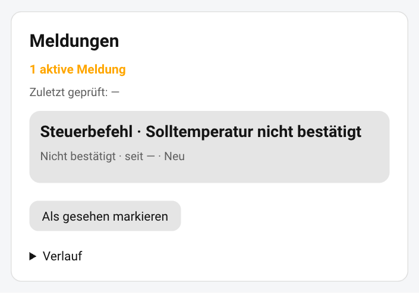

# Truma iNet Dashboard

[Deutsch](README.de.md)

**Dashboard cards only.** To use them you need a classic Truma iNet Box and the **[Truma iNet Bridge](https://github.com/Lorilonlon/truma-home-assistant-bridge)**, paired and connected to Home Assistant via MQTT. Install the bridge first. For schedules, also install its [timer helpers, script and automation](https://github.com/Lorilonlon/truma-home-assistant-bridge/blob/main/dashboard/TIMER.md).

Home Assistant dashboard cards for space heating, hot water, schedules and fault messages from the classic **Truma iNet Box**. The controls and status labels are in German.

## Dashboard preview

The cards below show simulated readings and an example notification.



<details>
<summary>Show the timer form and an example notification</summary>




</details>

## Requirements

Install and pair the [Truma iNet Bridge](https://github.com/Lorilonlon/truma-home-assistant-bridge) first. It provides the MQTT entities used by these cards. For schedules install the bridge project's [timer helpers, script and automation](https://github.com/Lorilonlon/truma-home-assistant-bridge/blob/main/dashboard/TIMER.md). Marking a message as seen acknowledges it in Home Assistant. Neither the Truma iNet System app nor the bridge can remotely reset a heater fault.

## Installation

1. Open HACS. Under **Custom repositories**, add this GitHub repository as **Dashboard** if it is not listed yet. [Open in HACS](https://my.home-assistant.io/redirect/hacs_repository/?owner=Lorilonlon&repository=truma-inet-dashboard&category=plugin)
2. Download **Truma iNet Dashboard** and reload the browser. In a storage-mode dashboard HACS registers the module. For YAML-managed resources, register `/hacsfiles/truma-inet-dashboard/truma-inet-dashboard.js` as a JavaScript module.
3. Add a manual card and paste the example below. Adjust entity IDs for your installation. If you already use the bridge's manually installed cards, keep your card configurations. Once the HACS resource is registered, remove the old dashboard resource entries for `camper-inet-card.js` and `camper-inet-fault-card.js` and reload.

```yaml
type: custom:camper-inet-card
kind: climate
entity: climate.truma_inet_heizung
```

Use `kind: water` with `select.truma_inet_warmwasser` for hot water. Both cards find the current or older default temperature sensor and show readings in read-only mode. If you renamed your sensor, set `temperature_entity` to its entity ID. Use `type: custom:camper-inet-timer-card` for schedules and `type: custom:camper-inet-fault-card` for messages. [Full example dashboard](https://github.com/Lorilonlon/truma-home-assistant-bridge/blob/main/dashboard.json).

Experimental community project. The controls operate a real heater. Test settings on site and follow the appliance instructions. Independent of Truma and Home Assistant. Developed with OpenAI Codex support. [MIT licence](LICENSE).
